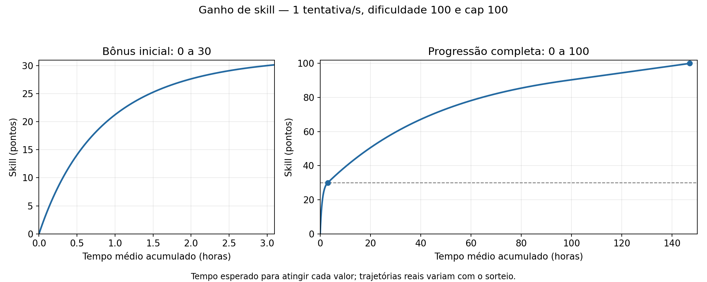

# juoforge-server

Network configuration: [standalone mode or juoforge-gateway integration](docs/network-transports.md).

Gump system: [components, usage examples, and limitations](docs/gumps.md).

An Ultima Online server written in Java. Gameplay rules are configured in
[`GamePlaySettings`](src/main/java/com/github/mayconr/juoserver/game/GamePlaySettings.java).

## Building with Java 25

Use JDK 25 and Maven 3.6.3 or later. Set `JAVA_HOME` to JDK 25 and confirm with
`mvn -version` that Maven is using that version. In IntelliJ, select JDK 25 for
the project and Maven runner/importer, then reload the POM.

```sh
mvn clean install
```

The build uses `--release 25`, without preview features. Lombok annotation
processing is explicitly configured in Maven. Spring Boot 3.5 manages compatible
dependency versions, including Lombok, Mockito, and Netty.

## Skills module

The module is accessible through `world.skill()` and provides these operations:

| Operation | Responsibility |
|---|---|
| `useSkill(player, skillId)` | Processes skill use and dispatches its behavior. |
| `startSkillAction(player, options)` | Schedules the player's preferred swing count and completion callback, reserving one action per player. Returns `false` if an action is already active. |
| `hasActiveAction(player)` | Reports whether the player has a scheduled action. |
| `tryGain(mobile, skillId, difficulty, context)` | Attempts a gain through the progression flow. |
| `setSkill(player, skillId, value)` | Sets the base value between zero and the cap and notifies the player, regardless of the lock. |

`startSkillAction` takes `SkillActionOptions`: `skillId`, optional `swingCount`,
`onSwing`, and `onComplete`. Completion defaults to a no-op callback.
The `onSwing` callback is required. The flow validates options and checks that the
skill exists in `UOFileReader`, without requiring the `hasAction` flag.

An explicit `swingCount` overrides the persistent preference for that action.
When omitted, the persistent player property `skill.swings` selects the count, defaulting
to 1 when missing or invalid. The flow reads it through `WorldMobile` at scheduling
time. The first swing runs on the next world update, with a fixed second of simulation
time between later swings and at most one swing per update. Swing
callbacks receive counts starting at 1; completion receives the total count once.

### Example: one swing on the next update

```java
int skillId = 45; // Mining
double difficulty = 100.0;

boolean started = world.skill().startSkillAction(player, SkillActionOptions.builder()
        .skillId(skillId)
        .onSwing(count -> world.skill().tryGain(
                player, skillId, difficulty, SkillGainContext.of(player)))
        .onComplete(count -> world.message().send(player, "Training complete."))
        .build());
```

`SkillActionOptions` belongs to `game.skill` and `SkillGainContext` to `game.model`.
With the default preference, the example schedules one attempt on the next world update.
To request more swings, set the player's persistent preference before scheduling:

```java
world.skill().setSwingCount(player, 60);
```

`setSwingCount` persists the preference and clamps the count to at least 1. Use
`.swingCount(3)` on the options builder to override the saved preference for one
action, without changing it. The minimum effective count is always 1.
`startSkillAction` does not grant gains automatically; the callback calls `tryGain`.
A false `started` means the player already has an action. The progression times
below assume continuous attempts, with one `tryGain` call per second and no pauses
between scheduled actions.

### Gain calculation

[`TryGainSkillFlowDefinition`](src/main/java/com/github/mayconr/juoserver/game/skill/flow/gain/TryGainSkillFlowDefinition.java)
executes skill resolution, random roll, gain calculation, application, and
notification, in that order. Formulas are isolated in
[`SkillGainCalculator`](src/main/java/com/github/mayconr/juoserver/game/skill/SkillGainCalculator.java).
If the roll fails, the flow ends without changing the skill.

Default `GamePlaySettings.Skills` parameters:

| Parameter | Default | Purpose |
|---|---:|---|
| `minGainChance` | `0.0` | Minimum gain chance per attempt. |
| `maxGainChance` | `0.5` | Maximum gain chance per attempt. |
| `balanceOffset` | `50` | Offset when comparing difficulty with the base value. |
| `cap` | `100` | Cap assigned to initial skills during character creation. |
| `beginnerGainMultiplier` | `19.77` | Initial gain multiplier. |
| `beginnerGainThreshold` | `30.0` | Value at which the initial bonus ends. |
| `baseGain` | `0.00113654` | Base gain per successful roll, before factors. |

```java
new GamePlaySettings.Skills(0.0, 0.5, 50, 100, 19.77, 30.0, 0.00113654)
```

In the formulas, `s` is the current base value, `c` is the individual skill cap,
`d` is difficulty, and `clamp(x, minimum, maximum)` bounds the value to the given
range. Changing the configured cap does not automatically modify existing skills.

**1. Gain chance**

```text
chance = clamp((d - s + balanceOffset) / 100, minGainChance, maxGainChance)
```

A roll occurs on every attempt. With `d = 100`, the chance stays at 50% throughout
progression from zero to 100. On average, this means one successful gain every
two attempts.

**2. Gain amount when the roll succeeds**

```text
capFactor        = clamp(1 - s / c, 0.1, 1.0)
difficultyFactor = clamp(d / c, 0.5, 1.5)
beginnerFactor   = 1 + (beginnerGainMultiplier - 1)
                      * clamp(1 - s / beginnerGainThreshold, 0, 1)

gain = baseGain * capFactor * difficultyFactor * beginnerFactor
```

The beginner factor uses this expression only when the multiplier is greater
than one and the threshold is positive; otherwise, it is one. With defaults,
it starts at 19.77x, falls to 10.385x at 15, and reaches 1x at 30. There is no
initial bonus beyond that point. The cap factor continues reducing gains until
90; between 90 and 100, it stays at 0.1. If the individual cap is zero or negative,
the calculated gain is zero.

Examples with difficulty and cap both equal to 100:

| Current skill | Cap factor | Beginner factor | Gain per success | Average gain per attempt at that value |
|---|---:|---:|---:|---:|
| 0 | 1.00 | 19.770 | 0.0224694 | 0.0112347 |
| 15 | 0.85 | 10.385 | 0.0100325 | 0.0050163 |
| 30 | 0.70 | 1.000 | 0.0007956 | 0.0003978 |
| 50 | 0.50 | 1.000 | 0.0005683 | 0.0002841 |
| 90 | 0.10 | 1.000 | 0.0001137 | 0.0000568 |

Average gain per attempt is `chance * gain`. The rate changes as the skill
progresses; dividing 100 by the initial rate does not correctly estimate total time.

**3. Application and notification**

`SkillValue.increase` applies gains only with lock `UP` and caps the value at the
individual cap. Fractional values accumulate. `SkillGained` is published only
when `(int) (newBase * 10)` exceeds `(int) (previousBase * 10)`, avoiding notifications
when the tenth displayed to the client has not changed.

### Chart: skill gain over time



[Vector version of the chart](docs/plots/skill-gain.svg).

The chart shows the **average time to reach each value**, with difficulty 100,
individual cap 100, lock `UP`, and continuous attempts every second. It is not a
guaranteed trajectory: each session varies with random rolls.

| Skill reached | Average cumulative time from zero |
|---|---:|
| 10 | 0.31 h - about 19 min |
| 20 | 0.89 h - about 53 min |
| 30 | 3.00 h |
| 40 | 10.54 h |
| 50 | 19.45 h |
| 60 | 30.36 h |
| 70 | 44.42 h |
| 80 | 64.24 h |
| 90 | 98.12 h |
| 100 | 147.00 h - 6 days and 3 hours |

Therefore, **zero to 30 takes approximately three hours; 30 to 100 takes another
six days of continuous training**. At eight hours of training per day, the total
is approximately 18.4 days of sessions, with all other conditions unchanged.

To calculate times, iterate through successful gains. At each value `s`, add
`1 / chance(s)` expected attempts and advance by the calculated gain:

```text
expectedTime += attemptInterval / chance(s)
s = min(c, s + gain(s))
```

This accounts for changing gains throughout progression. Regenerate the chart
with `python docs/plots/skill_gain.py`, with `matplotlib` installed. The script
replicates the defaults above and must be updated if the rules change.
`TryGainSkillFlowTest.defaultProgressionTargetsThreeHoursThenSixDays` checks the
calibration against the Java calculation.

Times vary with difficulty, individual cap, configuration, and attempt frequency.
If only the interval changes from one to two seconds, expected times double.
With zero chance or a lock other than `UP`, there is no progression.
