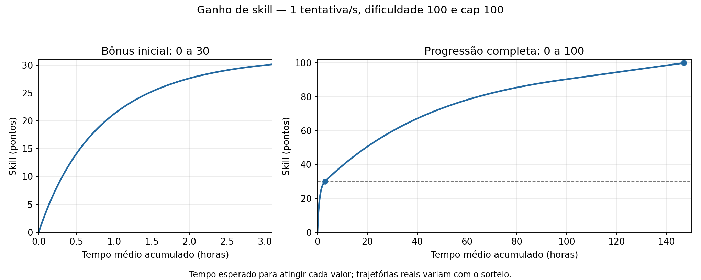

# juoforge-server

Servidor de Ultima Online em Java. As regras de gameplay são configuradas em
[`GamePlaySettings`](src/main/java/com/github/mayconr/juoserver/game/GamePlaySettings.java).

## Módulo de skills

O módulo é acessível por `world.skill()` e oferece estas operações:

| Operação | Responsabilidade |
|---|---|
| `useSkill(player, skillId)` | Processa o uso de uma skill e despacha seu comportamento. |
| `performSkill(player, options)` | Agenda swings e callbacks, reservando uma ação por player. Retorna `false` se já houver uma ação ativa. |
| `hasActiveAction(player)` | Informa se o player possui uma ação agendada. |
| `tryGain(mobile, skillId, difficulty, context)` | Executa uma tentativa de ganho pelo flow de progressão. |
| `setSkill(player, skillId, value)` | Define o valor base entre zero e o cap e notifica o player, independentemente do lock. |

`performSkill` recebe `SkillActionOptions`: `skillId`, `swings`, `delaySeconds`,
`swing` e `onComplete`. O padrão é um swing, intervalo zero e conclusão sem ação.
O callback `swing` é obrigatório. O flow valida as opções e a existência da skill
no `UOFileReader`, sem exigir o flag `hasAction`.

O primeiro swing ocorre na próxima atualização do mundo. Os demais respeitam
`delaySeconds`, em segundos de simulação, com no máximo um swing por atualização.
O callback recebe a quantidade de swings executados, começando em um.

### Exemplo: um swing por segundo

```java
int skillId = 45; // Mining
double difficulty = 100.0;

boolean started = world.skill().performSkill(player, SkillActionOptions.builder()
        .skillId(skillId)
        .swings(60)
        .delaySeconds(1.0)
        .swing(count -> world.skill().tryGain(
                player, skillId, difficulty, SkillGainContext.of(player)))
        .onComplete(count -> world.message().send(player, "Treino concluído."))
        .build());
```

`SkillActionOptions` pertence a `game.skill` e `SkillGainContext` a `game.model`.
O exemplo agenda 60 tentativas: a primeira na próxima atualização e as outras
com intervalo de um segundo. `performSkill` não concede ganho automaticamente;
é o callback que chama `tryGain`. Não é necessário agendar outra ação se `started`
for `false`. Para os tempos abaixo, pressupõe-se treino contínuo, sem pausas entre
ações e com uma chamada de `tryGain` por segundo.

### Cálculo de ganho

O [`TryGainSkillFlowDefinition`](src/main/java/com/github/mayconr/juoserver/game/skill/flow/gain/TryGainSkillFlowDefinition.java)
executa, nesta ordem: resolução da skill, sorteio, cálculo do ganho, aplicação e
notificação. As fórmulas estão isoladas em
[`SkillGainCalculator`](src/main/java/com/github/mayconr/juoserver/game/skill/SkillGainCalculator.java).
Quando o sorteio falha, o flow termina sem alterar a skill.

Os parâmetros padrão de `GamePlaySettings.Skills` são:

| Parâmetro | Padrão | Função |
|---|---:|---|
| `minGainChance` | `0.0` | Chance mínima de ganhar por tentativa. |
| `maxGainChance` | `0.5` | Chance máxima de ganhar por tentativa. |
| `balanceOffset` | `50` | Deslocamento na comparação entre dificuldade e valor base. |
| `cap` | `100` | Cap atribuído às skills iniciais na criação do personagem. |
| `beginnerGainMultiplier` | `19.77` | Multiplicador inicial do ganho. |
| `beginnerGainThreshold` | `30.0` | Valor a partir do qual o bônus inicial termina. |
| `baseGain` | `0.00113654` | Ganho base por sorteio bem-sucedido, antes dos fatores. |

```java
new GamePlaySettings.Skills(0.0, 0.5, 50, 100, 19.77, 30.0, 0.00113654)
```

Nas fórmulas, `s` é o valor base atual, `c` é o cap da própria skill, `d` é a
dificuldade, e `clamp(x, mínimo, máximo)` limita o valor ao intervalo informado.
Alterar o cap da configuração não modifica automaticamente skills já existentes.

**1. Chance de ganho**

```text
chance = clamp((d - s + balanceOffset) / 100, minGainChance, maxGainChance)
```

O sorteio acontece em cada tentativa. Com `d = 100`, a chance permanece em 50%
durante toda a progressão de zero a 100. Isso corresponde, em média, a um ganho
bem-sucedido a cada duas tentativas.

**2. Quantidade de ganho quando o sorteio passa**

```text
fatorCap         = clamp(1 - s / c, 0.1, 1.0)
fatorDificuldade = clamp(d / c, 0.5, 1.5)
fatorIniciante   = 1 + (beginnerGainMultiplier - 1)
                      × clamp(1 - s / beginnerGainThreshold, 0, 1)

ganho = baseGain × fatorCap × fatorDificuldade × fatorIniciante
```

O fator iniciante só usa essa expressão quando o multiplicador é maior que um e
o threshold é positivo; caso contrário, vale um. Com os padrões, começa em 19,77×,
cai para 10,385× em 15 e chega a 1× em 30. A partir daí não há bônus inicial.
O fator de cap continua reduzindo o ganho até 90; entre 90 e 100, permanece em 0,1.
Se o cap individual for menor ou igual a zero, o ganho calculado é zero.

Exemplos para dificuldade e cap iguais a 100:

| Skill atual | Fator de cap | Fator iniciante | Ganho por sucesso | Ganho médio por tentativa naquele valor |
|---|---:|---:|---:|---:|
| 0 | 1,00 | 19,770 | 0,0224694 | 0,0112347 |
| 15 | 0,85 | 10,385 | 0,0100325 | 0,0050163 |
| 30 | 0,70 | 1,000 | 0,0007956 | 0,0003978 |
| 50 | 0,50 | 1,000 | 0,0005683 | 0,0002841 |
| 90 | 0,10 | 1,000 | 0,0001137 | 0,0000568 |

O ganho médio por tentativa é `chance × ganho`. A taxa muda conforme a skill
evolui; dividir 100 pela taxa inicial não estima corretamente o tempo total.

**3. Aplicação e notificação**

`SkillValue.increase` aplica o ganho somente com lock `UP` e limita o valor ao
cap individual. Os valores fracionários são acumulados. `SkillGained` é publicado
apenas quando `(int) (novoBase × 10)` supera `(int) (baseAnterior × 10)`, evitando
notificações quando o décimo apresentado ao cliente ainda não mudou.

### Gráfico: ganho de skill × tempo



[Versão vetorial do gráfico](docs/plots/skill-gain.svg).

O gráfico mostra o **tempo médio para atingir cada valor**, com dificuldade 100,
cap individual 100, lock `UP` e tentativas contínuas a cada segundo. Não representa
uma trajetória garantida: cada sessão varia com os sorteios.

| Skill atingida | Tempo médio acumulado desde zero |
|---|---:|
| 10 | 0,31 h — cerca de 19 min |
| 20 | 0,89 h — cerca de 53 min |
| 30 | 3,00 h |
| 40 | 10,54 h |
| 50 | 19,45 h |
| 60 | 30,36 h |
| 70 | 44,42 h |
| 80 | 64,24 h |
| 90 | 98,12 h |
| 100 | 147,00 h — 6 dias e 3 horas |

Portanto, **zero a 30 leva aproximadamente três horas; 30 a 100 leva mais seis
dias de treino contínuo**. Com oito horas de treino por dia, o total corresponde
a aproximadamente 18,4 dias de sessões, mantendo as demais condições.

Para calcular os tempos, percorremos os ganhos bem-sucedidos. Em cada valor `s`,
somamos `1 / chance(s)` tentativas esperadas e avançamos pelo ganho calculado:

```text
tempoEsperado += intervaloEntreTentativas / chance(s)
s = min(c, s + ganho(s))
```

Isso considera a variação do ganho durante toda a progressão. O gráfico pode ser
regenerado com `python docs/plots/skill_gain.py`, com `matplotlib` instalado.
O script replica os padrões acima; deve ser atualizado se as regras mudarem.
O teste `TryGainSkillFlowTest.defaultProgressionTargetsThreeHoursThenSixDays`
confere a calibração usando o cálculo Java.

Os tempos mudam com dificuldade, cap individual, configuração e frequência de
tentativas. Se apenas o intervalo passar de um para dois segundos, os tempos
esperados dobram. Com chance zero ou lock diferente de `UP`, não há progressão.
