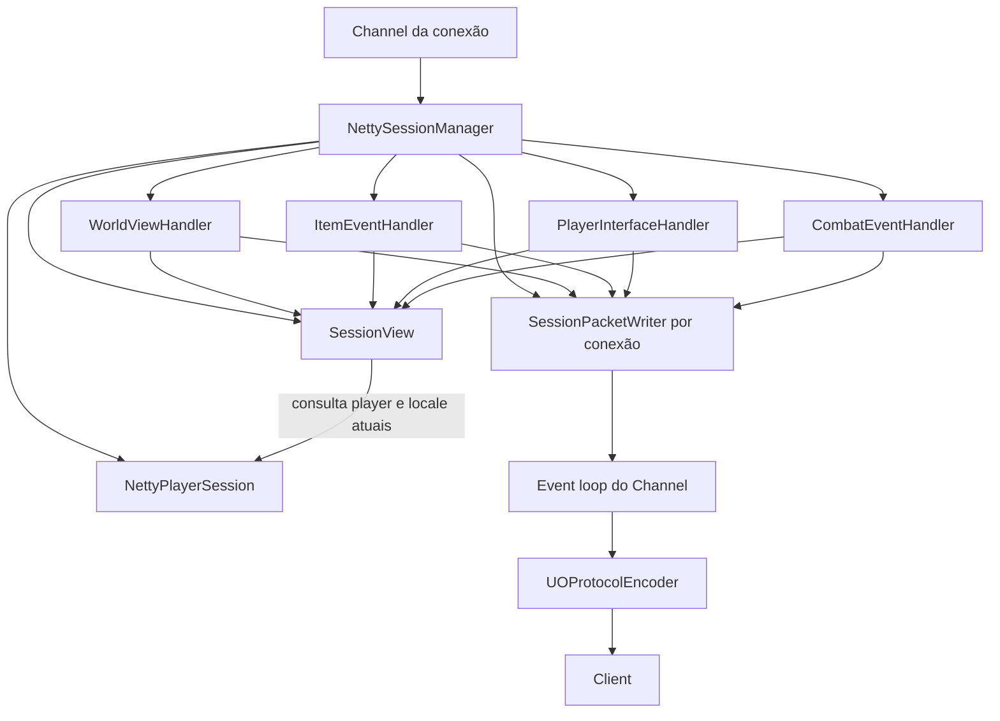
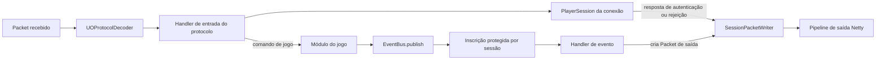
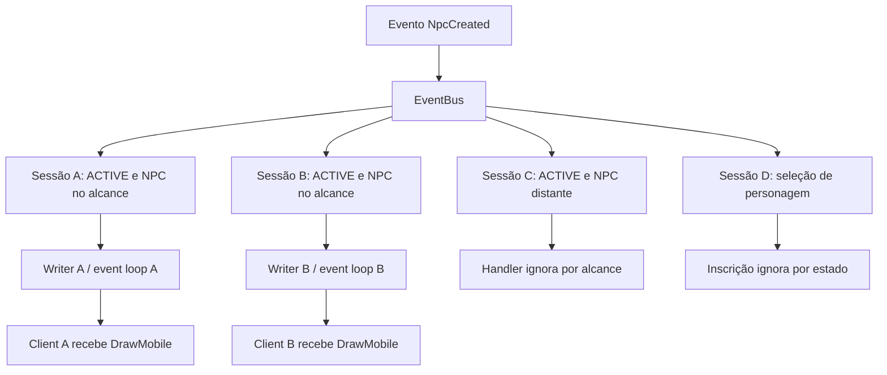
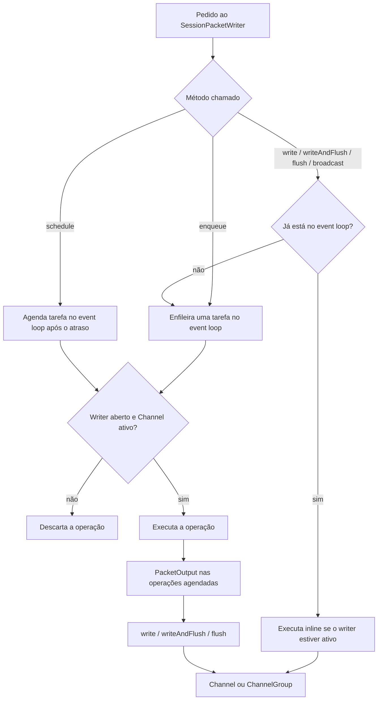
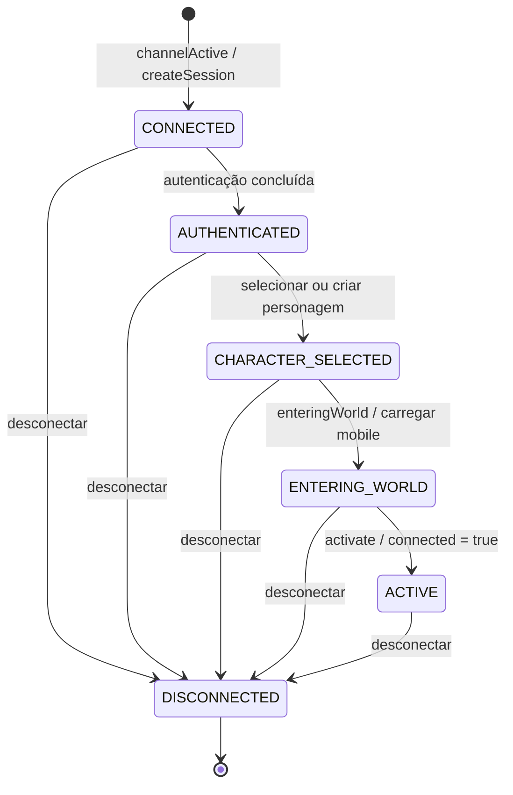
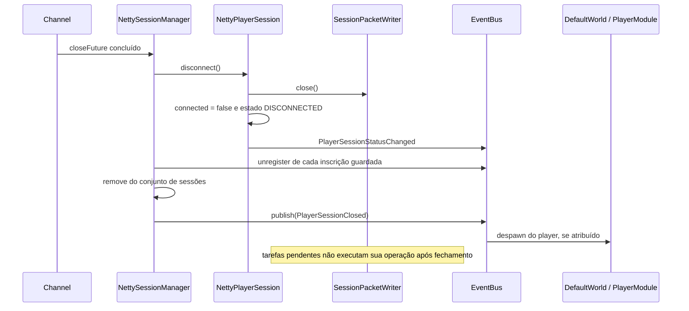

# Sessões e envio de packets

Este documento descreve a organização atual de `network.session`, a distribuição de pedidos de envio e os controles aplicados antes de escrever na conexão.

## Organização dos componentes

```text
network/session/
├── NettySessionManager.java       # Criação, inscrições e encerramento
├── NettyPlayerSession.java        # Autenticação e ciclo de vida
├── PlayerSession.java            # Contrato usado pelos handlers de entrada
├── SessionManager.java
├── SessionState.java
├── SessionAttributes.java
├── SessionView.java              # Leitura do player/locale e critérios de alcance
├── SessionPacketWriter.java      # Agendamento e escrita no event loop
├── PacketOutput.java             # Delegate de escrita e flush
├── handler/
│   ├── WorldViewHandler.java
│   ├── ItemEventHandler.java
│   ├── PlayerInterfaceHandler.java
│   └── CombatEventHandler.java
└── i18n/                         # Locale e localização de mensagens
```

O manager cria uma sessão, um writer e quatro handlers por conexão. Os handlers compartilham o writer daquela conexão e uma visão de leitura da sessão. O EventBus e o ChannelGroup são compartilhados entre conexões.



| Componente | Responsabilidade |
| --- | --- |
| `NettyPlayerSession` | Estado, conta, seleção/criação, carregamento, ativação e desconexão. |
| `NettySessionManager` | Instanciar componentes, registrar eventos e remover as mesmas inscrições no fechamento. |
| `WorldViewHandler` | Login visual, visão próxima, movimento, aparecimento e remoção de mobiles. |
| `ItemEventHandler` | Equipamentos, itens no chão, containers, stacks e atualizações. |
| `PlayerInterfaceHandler` | Mensagens, fala, gumps, skills, vendor, spellbook e packets de debug. |
| `CombatEventHandler` | Animações, modo de combate, dano, morte e ressurreição. |
| `SessionView` | Consultar player/locale atuais, identidade, alcance e presença. |
| `SessionPacketWriter` | Encaminhar saída para o event loop e bloquear operações após fechamento. |

## Como entra um pedido de envio

Existem dois caminhos principais:

1. **Resposta ao protocolo:** o decoder converte os bytes recebidos em um packet. Um `PlayerSessionChannelInboundHandler` recupera a sessão no atributo `PLAYER_SESSION_KEY` do Channel e chama a operação correspondente. Autenticação e rejeição enviam respostas pelo writer da sessão.
2. **Evento do jogo:** um módulo publica um evento, como `NpcCreated`, `ItemUpdated` ou `RawPacketSent`. Cada inscrição daquele tipo avalia a sessão e seu handler decide se deve enviar packets ao próprio client.



O bus publica de forma síncrona na thread do publicador. A inscrição criada por `NettySessionManager.Event.forSession` transfere o processamento para o event loop da conexão.

## Envio para um client

Exemplo: `RawPacketSent` informa o player destinatário e o packet. O bus distribui o evento às inscrições, mas somente o handler cujo player tem o mesmo ID envia o conteúdo.

```mermaid
sequenceDiagram
    participant Game as Módulo do jogo
    participant Bus as EventBus
    participant Guard as Inscrição da sessão
    participant Writer as SessionPacketWriter
    participant Loop as Event loop do Channel
    participant Handler as PlayerInterfaceHandler
    participant Encoder as UOProtocolEncoder
    participant Client
    Game->>Bus: publish(RawPacketSent)
    Bus->>Guard: entrega do evento
    alt sessão ACTIVE e conexão aberta
        Guard->>Writer: enqueue(operação de dispatch)
        Writer-->>Loop: enfileira tarefa
        Loop->>Guard: executa tarefa
        Note over Guard: synchronized(session) e nova checagem de ACTIVE
        Guard->>Handler: onRawPacketSent(event)
        Handler->>Handler: compara ID do destinatário
        alt destinatário corresponde à sessão
            Handler->>Writer: enqueue(operação de escrita)
            Writer-->>Loop: enfileira nova tarefa
            Loop->>Handler: executa operação com PacketOutput
            Handler->>Writer: packets.write(packet) e flush()
            Writer->>Encoder: Channel.write e flush
            Encoder->>Encoder: Packet.writesTo(ByteBuf) e Huffman
            Encoder-->>Client: bytes pela conexão
        end
    else sessão indisponível
        Note over Guard: evento ignorado
    end
```

Alguns handlers fazem uma segunda chamada a `enqueue`, como nesse exemplo. Ela cria outra tarefa mesmo quando já está no event loop. Outros escrevem diretamente pelo writer, que executa inline quando já está no loop.

Respostas de autenticação e rejeição não passam pelo filtro `ACTIVE` dos eventos de jogo: precisam funcionar antes da entrada no mundo. Elas continuam sujeitas ao controle de conexão aberta do writer.

## Envio para vários clients

Os handlers usam a distribuição do evento entre as sessões. Cada handler escreve somente no seu Channel. Ao criar um NPC, por exemplo, as sessões ativas cujos players estão no alcance recebem `DrawMobile`.



| Situação | Distribuição atual |
| --- | --- |
| Packet de debug direcionado | Apenas a sessão com o ID destinatário envia. |
| Criação e atualização de entidades próximas | Cada sessão aplica critérios do handler, como alcance e presença. |
| Mensagem com `TextType.BROADCAST` | Cada sessão ativa envia a mensagem ao próprio client. |
| Remoção de NPC/player/item | Sessões ativas recebem `DeleteObject` sem exigir presença online ou alcance atual da entidade removida. |
| Conteúdo de container equipado | Restrito ao dono; containers aninhados têm a cadeia de localização consultada. |

O writer também mantém `broadcast` e `broadcastAndFlush`, acessíveis dentro do pacote `session`. Eles usam o ChannelGroup, que contém conexões adicionadas em `channelActive` e removidas em `channelInactive`. Esses métodos encaminham ao grupo inteiro e **não aplicam filtros de ACTIVE, alcance ou propriedade por destinatário**. A chamada ao grupo passa pelo event loop do writer de origem; o Netty encaminha as operações aos Channels de destino.

Os quatro handlers de `session.handler` não usam broadcasts de grupo. Isso evita que cada inscrição repita um envio para todos os clients.

## Escrita, enfileiramento e flush



- `enqueue` sempre enfileira a operação inteira. Não faz flush automático.
- `schedule` executa após o atraso no event loop, se o writer ainda estiver ativo.
- `write` entrega o packet ao pipeline sem solicitar flush.
- `flush` solicita a saída das escritas pendentes; `writeAndFlush` combina as duas operações.
- `PacketOutput` oferece somente escrita e flush. Seu uso fora do event loop lança `IllegalStateException`.
- Uma tarefa pode escrever vários packets e realizar um único flush. Login e movimento mantêm suas próprias sequências e limites de flush.
- Cada conexão tem sua fila. Não existe uma ordem global de entrega entre clients nem confirmação de recebimento do client nessa API.

Exemplo de envio agrupado:

```java
packetWriter.enqueue(packets -> {
    packets.write(firstPacket);
    packets.write(secondPacket);
    packets.flush();
});
```

## Controles e concorrência

| Camada | Controle |
| --- | --- |
| Inscrição do evento | Verifica `session.isActive()` antes de enfileirar e ao executar, sob `synchronized(session)`. |
| Estado da sessão | `ACTIVE` é necessário para eventos de jogo. Ativação, desconexão e etapas sensíveis de carregamento usam o monitor da sessão. |
| Writer | Exige `!closed && channel.isActive()`. Tarefas enfileiradas/agendadas reavaliam a condição ao executar. |
| Destinatário e alcance | `SessionView` centraliza identidade, alcance e presença. Cada handler escolhe quais critérios aplicar ao evento. |
| Players offline | `shouldReceiveUpdate` exclui players desconectados. A visão próxima também exige `MobileVisibility.isVisible`, que considera vida e presença. |
| Remoções | Podem enviar `DeleteObject` após a entidade sair do índice ou ficar offline, permitindo limpar o client. |
| Containers | O handler verifica dono ou localização no chão e percorre containers pais com proteção contra ciclos. |
| EventBus | `ConcurrentHashMap` e `CopyOnWriteArrayList` permitem publicação junto de registro/remoção de inscrições. |
| Sessões registradas | O manager mantém um conjunto concorrente. |

O event loop serializa operações de uma conexão. Isso não transforma todos os objetos do mundo em snapshots imutáveis: packets e eventos podem guardar referências a entidades consultadas posteriormente. Uma inscrição já capturada pelo bus também pode ser chamada após a remoção do listener; as verificações de estado e de writer fechado impedem saída da sessão encerrada.

## Ciclo de vida e encerramento



O diagrama mostra o fluxo principal implementado. `DISCONNECTING` existe no enum e é tratado como indisponível, mas `disconnect()` faz a transição diretamente para `DISCONNECTED`.



`ClientConnectedHandlerAdapter.channelInactive` também remove o Channel do grupo e chama `disconnect()`, que é idempotente. Se o carregamento terminar depois da desconexão, `enteringWorld()` limpa o player carregado e conclui excepcionalmente, impedindo ativação tardia.

## Referências no código

- [NettySessionManager](../src/main/java/com/github/mayconr/juoserver/network/session/NettySessionManager.java)
- [NettyPlayerSession](../src/main/java/com/github/mayconr/juoserver/network/session/NettyPlayerSession.java)
- [SessionPacketWriter](../src/main/java/com/github/mayconr/juoserver/network/session/SessionPacketWriter.java)
- [SessionView](../src/main/java/com/github/mayconr/juoserver/network/session/SessionView.java)
- [Handlers de eventos](../src/main/java/com/github/mayconr/juoserver/network/session/handler/)
- [DefaultEventBus](../src/main/java/com/github/mayconr/juoserver/infrastructure/eventbus/DefaultEventBus.java)
- [ClientConnectedHandlerAdapter](../src/main/java/com/github/mayconr/juoserver/infrastructure/server/ClientConnectedHandlerAdapter.java)
- [UOProtocolEncoder](../src/main/java/com/github/mayconr/juoserver/infrastructure/server/UOProtocolEncoder.java)
