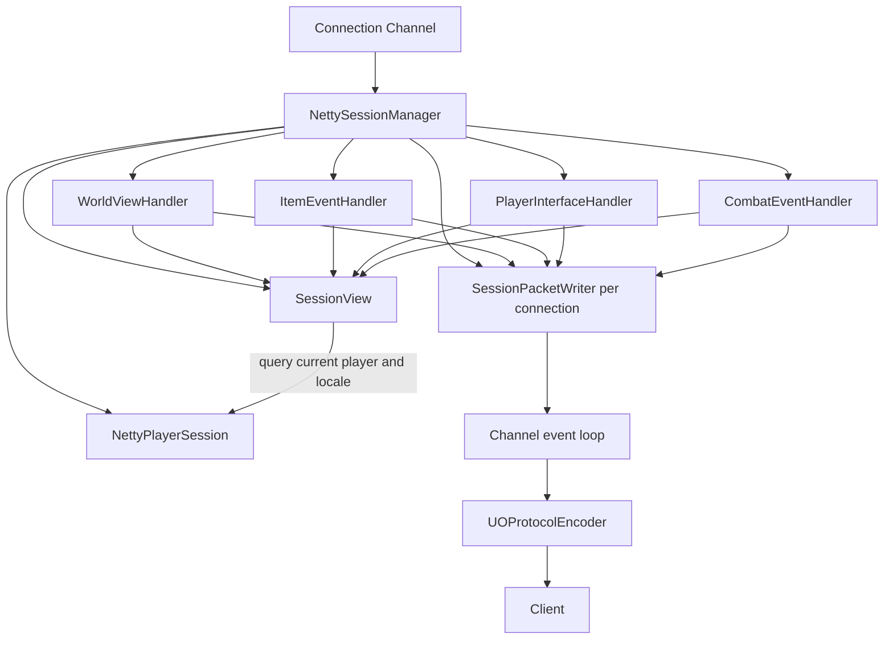
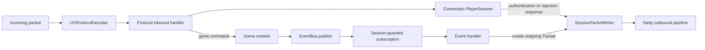
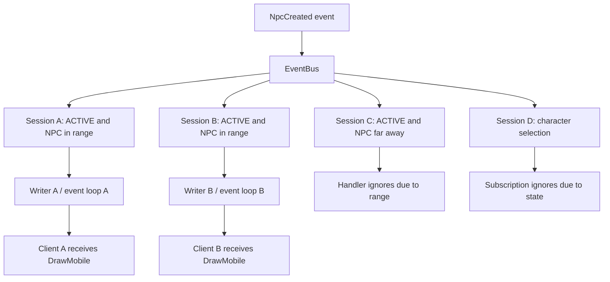
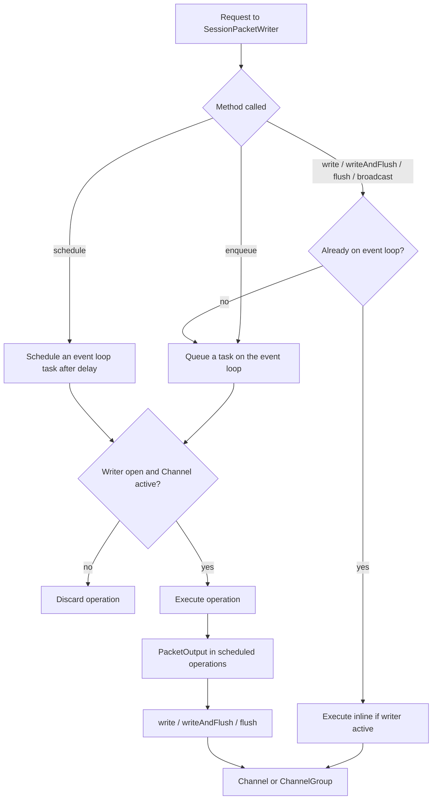
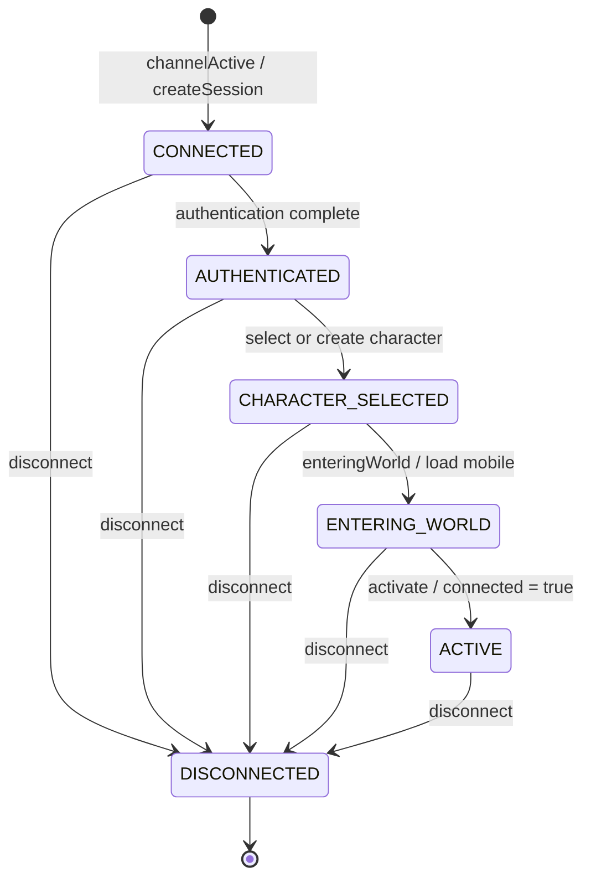
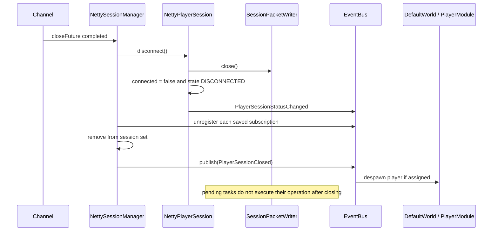

# Sessions and packet output

This document describes the current organization of `network.session`, how send requests are distributed, and the controls applied before writing to a connection.

## Component organization

```text
network/session/
|-- NettySessionManager.java       # Creation, subscriptions, and shutdown
|-- NettyPlayerSession.java        # Authentication and lifecycle
|-- PlayerSession.java             # Contract used by incoming handlers
|-- SessionManager.java
|-- SessionState.java
|-- SessionAttributes.java
|-- SessionView.java               # Player/locale access and range criteria
|-- SessionPacketWriter.java       # Scheduling and writes on the event loop
|-- PacketOutput.java              # Write and flush delegate
|-- handler/
|   |-- WorldViewHandler.java
|   |-- ItemEventHandler.java
|   |-- PlayerInterfaceHandler.java
|   `-- CombatEventHandler.java
`-- i18n/                         # Locale and message localization
```

The manager creates a session, a writer, and four handlers per connection. Handlers share that connection's writer and a read view of the session. The EventBus and ChannelGroup are shared across connections.



| Component | Responsibility |
| --- | --- |
| `NettyPlayerSession` | State, account, selection/creation, loading, activation, and disconnection. |
| `NettySessionManager` | Instantiate components, register events, and remove the same subscriptions on closing. |
| `WorldViewHandler` | Visual login, nearby view, movement, mobile appearance and removal. |
| `ItemEventHandler` | Equipment, ground items, containers, stacks, and updates. |
| `PlayerInterfaceHandler` | Messages, speech, gumps, skills, vendor, spellbook, and debug packets. |
| `CombatEventHandler` | Animations, combat mode, damage, death, and resurrection. |
| `SessionView` | Query current player/locale, identity, range, and presence. |
| `SessionPacketWriter` | Forward output to the event loop and block operations after closing. |

## How a send request enters

There are two main paths:

1. **Protocol response:** the decoder converts incoming bytes into a packet. A `PlayerSessionChannelInboundHandler` retrieves the session from the Channel's `PLAYER_SESSION_KEY` attribute and calls the corresponding operation. Authentication and rejection send responses through the session writer.
2. **Game event:** a module publishes an event such as `NpcCreated`, `ItemUpdated`, or `RawPacketSent`. Each subscription of that type evaluates its session, and its handler decides whether to send packets to its own client.



The bus publishes synchronously on the publisher's thread. The subscription created by `NettySessionManager.Event.forSession` transfers processing to the connection's event loop.

## Sending to one client

For example, `RawPacketSent` provides the recipient player and packet. The bus distributes the event to subscriptions, but only the handler whose player has the matching ID sends the content.

```mermaid
sequenceDiagram
    participant Game as Game module
    participant Bus as EventBus
    participant Guard as Session subscription
    participant Writer as SessionPacketWriter
    participant Loop as Channel event loop
    participant Handler as PlayerInterfaceHandler
    participant Encoder as UOProtocolEncoder
    participant Client
    Game->>Bus: publish(RawPacketSent)
    Bus->>Guard: deliver event
    alt session ACTIVE and connection open
        Guard->>Writer: enqueue(dispatch operation)
        Writer-->>Loop: queue task
        Loop->>Guard: execute task
        Note over Guard: synchronized(session) and recheck ACTIVE
        Guard->>Handler: onRawPacketSent(event)
        Handler->>Handler: compare recipient ID
        alt recipient matches session
            Handler->>Writer: enqueue(write operation)
            Writer-->>Loop: queue another task
            Loop->>Handler: execute operation with PacketOutput
            Handler->>Writer: packets.write(packet) and flush()
            Writer->>Encoder: Channel.write and flush
            Encoder->>Encoder: Packet.writesTo(ByteBuf) and Huffman
            Encoder-->>Client: bytes over connection
        end
    else session unavailable
        Note over Guard: event ignored
    end
```

Some handlers make a second `enqueue` call, as in this example. It creates another task even when already on the event loop. Others write directly through the writer, which executes inline when already on the loop.

Authentication and rejection responses do not pass through the game event `ACTIVE` filter: they must work before entering the world. They remain subject to the writer's open-connection checks.

## Sending to multiple clients

Handlers use event distribution across sessions. Each handler writes only to its own Channel. When an NPC is created, for example, active sessions whose players are in range receive `DrawMobile`.



| Situation | Current distribution |
| --- | --- |
| Targeted debug packet | Only the session with the recipient ID sends it. |
| Nearby entity creation and updates | Each session applies handler criteria such as range and presence. |
| Message with `TextType.BROADCAST` | Each active session sends the message to its own client. |
| NPC/player/item removal | Active sessions receive `DeleteObject` without requiring online presence or the removed entity's current range. |
| Equipped container contents | Restricted to the owner; nested containers have their location chain checked. |

The writer also provides `broadcast` and `broadcastAndFlush`, accessible within the `session` package. They use the ChannelGroup, which contains connections added in `channelActive` and removed in `channelInactive`. These methods forward to the entire group and **do not apply per-recipient ACTIVE, range, or ownership filters**. The group call passes through the originating writer's event loop; Netty forwards operations to destination Channels.

The four `session.handler` handlers do not use group broadcasts. This prevents each subscription from repeating a send to all clients.

## Writing, queueing, and flushing



- `enqueue` always queues the entire operation. It does not flush automatically.
- `schedule` executes after the delay on the event loop if the writer is still active.
- `write` passes the packet to the pipeline without requesting a flush.
- `flush` requests output of pending writes; `writeAndFlush` combines both operations.
- `PacketOutput` provides only writing and flushing. Using it outside the event loop throws `IllegalStateException`.
- A task can write several packets and perform a single flush. Login and movement retain their own sequences and flush boundaries.
- Each connection has its own queue. This API provides neither a global delivery order across clients nor client receipt acknowledgments.

Example of grouped output:

```java
packetWriter.enqueue(packets -> {
    packets.write(firstPacket);
    packets.write(secondPacket);
    packets.flush();
});
```

## Controls and concurrency

| Layer | Control |
| --- | --- |
| Event subscription | Checks `session.isActive()` before queueing and when executing, under `synchronized(session)`. |
| Session state | `ACTIVE` is required for game events. Activation, disconnection, and sensitive loading stages use the session monitor. |
| Writer | Requires `!closed && channel.isActive()`. Queued/scheduled tasks recheck the condition when executing. |
| Recipient and range | `SessionView` centralizes identity, range, and presence. Each handler chooses which criteria to apply to an event. |
| Offline players | `shouldReceiveUpdate` excludes disconnected players. The nearby view also requires `MobileVisibility.isVisible`, which considers life and presence. |
| Removals | Can send `DeleteObject` after an entity leaves the index or goes offline, allowing client cleanup. |
| Containers | The handler checks ownership or ground location and traverses parent containers with cycle protection. |
| EventBus | `ConcurrentHashMap` and `CopyOnWriteArrayList` allow publication alongside subscription registration/removal. |
| Registered sessions | The manager keeps a concurrent set. |

The event loop serializes operations for a connection. This does not turn all world objects into immutable snapshots: packets and events may hold entity references queried later. A subscription already captured by the bus may also be called after listener removal; state and closed-writer checks prevent output from a closed session.

## Lifecycle and shutdown



The diagram shows the implemented main flow. `DISCONNECTING` exists in the enum and is treated as unavailable, but `disconnect()` transitions directly to `DISCONNECTED`.



`ClientConnectedHandlerAdapter.channelInactive` also removes the Channel from the group and calls the idempotent `disconnect()`. If loading completes after disconnection, `enteringWorld()` clears the loaded player and completes exceptionally, preventing late activation.

## Code references

- [NettySessionManager](../src/main/java/com/github/mayconr/juoserver/network/session/NettySessionManager.java)
- [NettyPlayerSession](../src/main/java/com/github/mayconr/juoserver/network/session/NettyPlayerSession.java)
- [SessionPacketWriter](../src/main/java/com/github/mayconr/juoserver/network/session/SessionPacketWriter.java)
- [SessionView](../src/main/java/com/github/mayconr/juoserver/network/session/SessionView.java)
- [Event handlers](../src/main/java/com/github/mayconr/juoserver/network/session/handler/)
- [DefaultEventBus](../src/main/java/com/github/mayconr/juoserver/infrastructure/eventbus/DefaultEventBus.java)
- [ClientConnectedHandlerAdapter](../src/main/java/com/github/mayconr/juoserver/infrastructure/server/ClientConnectedHandlerAdapter.java)
- [UOProtocolEncoder](../src/main/java/com/github/mayconr/juoserver/infrastructure/server/UOProtocolEncoder.java)
