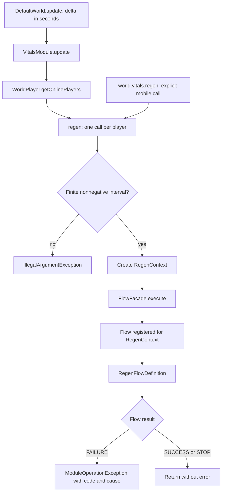
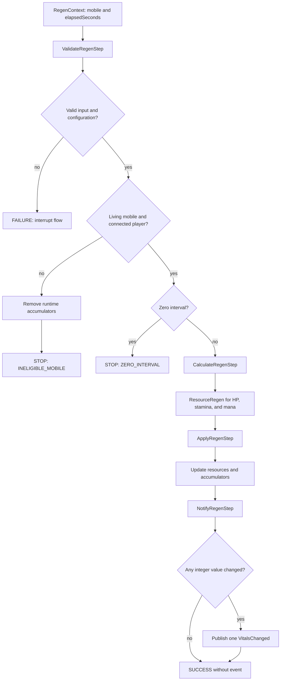
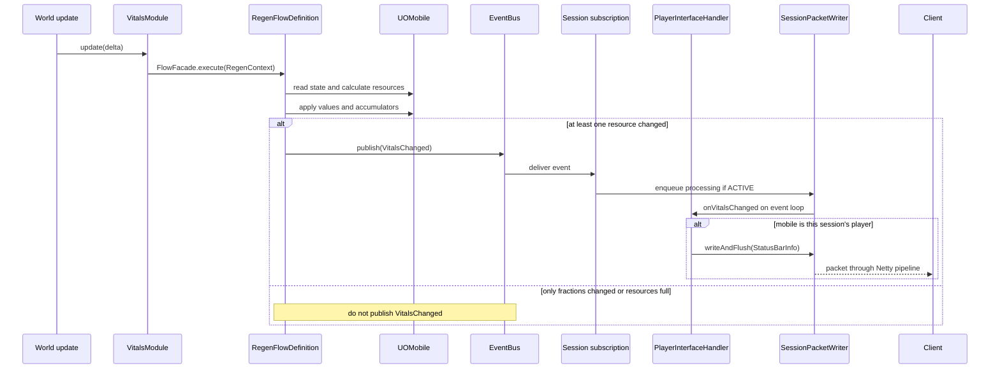

# Vitals and regeneration

The `game.vitals` module controls HP, stamina, and mana regeneration. It is independent of combat and exposes `world.vitals().regen(mobile, elapsedSeconds)`.

This document describes the current implementation. Damage still changes HP through the damage flow; death and resurrection remain in the mobile module. Extracting regeneration did not centralize all resource changes in vitals.

## Attributes and resources

| Attribute used in calculation | Regenerated resource | Current / maximum value |
| --- | --- | --- |
| STR (`strength`) | HP | `hitpoints` / `maxHitpoints` |
| DEX (`dexterity`) | Stamina | `stamina` / `maxStamina` |
| INT (`intelligence`) | Mana | `mana` / `maxMana` |

STR, DEX, and INT are formula inputs; regeneration does not increase these attributes or recalculate resource maximums.

## Organization

```text
game/vitals/
|-- WorldVitals.java                # Public regeneration API
|-- VitalsModule.java               # API + WorldModule lifecycle
|-- VitalsModuleImpl.java           # Updates and execution through FlowFacade
`-- flow/regen/
    |-- RegenContext.java           # Mobile, interval, and per-resource results
    |-- RegenFlowDefinition.java    # Composition of the four steps
    |-- ValidateRegenStep.java
    |-- CalculateRegenStep.java
    |-- ApplyRegenStep.java
    `-- NotifyRegenStep.java
```

`FlowRegistryFactory` registers `RegenFlowDefinition` for `RegenContext`. During initialization, `VitalsModuleImpl` receives `FlowFacade` through `ModuleContext`.

## Entry points and execution

`DefaultWorld.update(delta)` calls `VitalsModule.update(delta)`. The module queries `WorldPlayer.getOnlinePlayers()` and runs regeneration once per player, using the full `delta` in seconds. Accumulators preserve fractional progress between updates.

Living NPCs are also accepted by the API but do not participate in this automatic iteration: they require an explicit call. Disconnected players and dead mobiles do not regenerate.



The flow is synchronous: calculation, application, and event publication occur during the facade call. It does not schedule a thread or use the network event loop to change resources. The session layer forwards outgoing notifications to its own event loop.

## Flow steps



| Step | Behavior |
| --- | --- |
| `ValidateRegenStep` | Checks mobile, interval, and saturation factor; stops for dead mobiles, offline players, or a zero interval. Rejecting a dead/offline mobile removes its fractional progress. |
| `CalculateRegenStep` | Reads resources, attributes, and accumulators. Calculates all three results without changing the mobile or its accumulators. |
| `ApplyRegenStep` | Writes new accumulators and applies only resources whose integer value changed. |
| `NotifyRegenStep` | Publishes one `VitalsChanged` if at least one of the three resources changed. |

Each `ResourceRegen` result contains `previous`, `next`, and `remainder`. The context keeps separate results for HP, stamina, and mana.

### Validation and stopping

| Condition | Flow code | Effect |
| --- | --- | --- |
| Missing mobile | `MISSING_MOBILE` | FAILURE; no calculation or application. |
| Negative, NaN, or infinite interval | `INVALID_INTERVAL` | FAILURE when using the flow directly. The module API's early validation throws `IllegalArgumentException`. |
| `saturationFactor <= 0` | `INVALID_REGEN_SETTINGS` | FAILURE; no resource changes. |
| Dead mobile or disconnected player | `INELIGIBLE_MOBILE` | STOP; removes all three runtime accumulators. |
| Zero interval for an eligible mobile | `ZERO_INTERVAL` | STOP; preserves resources and accumulators. |

Order matters: eligibility is checked before the zero interval. A dead/offline mobile has its accumulators removed even with a zero interval, provided input and configuration are valid.

## Regeneration formula

Calculation is performed independently for each resource.

| Symbol | Meaning |
| --- | --- |
| `S` | Effective attribute: `max(0, stat)`. |
| `K` | `settings.mobile().vitals().saturationFactor()`, which must be positive. |
| `dt` | Elapsed time in seconds. |
| `A` | Previous fractional accumulator, initially zero. |
| `C` | Current resource value. |
| `M` | Maximum resource value. |

For `C < M`:

```text
S = max(0, stat)
rate = 0.1 + S / (S + K)                   # points per second
accumulated = A + rate * dt
capacity = M - C
gain = min(floor(accumulated + 1e-9), capacity)
next = C + gain

if next == M:
    remainder = 0
else:
    remainder = max(0, accumulated - gain)
```

`1e-9` is a tolerance for floating-point errors near an integer. It prevents a total represented as `0.9999999999999999` from failing to grant a point.

If `C >= M`, the step keeps the current value and returns a zero accumulator. Regeneration therefore prevents new gains from exceeding the maximum but does not correct a value already above the maximum due to another change.

### Effect of the saturation factor

The examples below use **K = 100 only to illustrate the formula**, without asserting that this is the shard's configured value.

| Effective attribute | Calculation | Approximate rate |
| --- | --- | --- |
| 0 | `0.1 + 0 / 100` | 0.1 points/s |
| 50 | `0.1 + 50 / 150` | 0.433333 points/s |
| 100 | `0.1 + 100 / 200` | 0.6 points/s |
| 200 | `0.1 + 200 / 300` | 0.766667 points/s |

A negative attribute is treated as zero. For the same positive attribute, increasing K reduces the rate. As the attribute grows, `S / (S + K)` approaches 1; the rate approaches 1.1 points/s.

### Example 1: recovery in one call

Consider HP = 50/100, STR = 100, K = 100, a zero accumulator, and a 10-second interval:

```text
rate = 0.1 + 100 / (100 + 100) = 0.6
accumulated = 0 + 0.6 * 10 = 6
capacity = 100 - 50 = 50
gain = min(6, 50) = 6
next = 50 + 6 = 56
remainder = 6 - 6 = 0
```

Result: **HP = 56/100**. DEX and INT use the same formula for stamina and mana, with their own values and accumulators.

### Example 2: preserving fractions between ticks

With the same STR and K, initial HP 50/100, and 1-second updates:

| Tick | HP before | Previous accumulator | Total after adding 0.6 | Gain | HP after | Remainder |
| --- | --- | --- | --- | --- | --- | --- |
| 1 | 50 | 0.0 | 0.6 | 0 | 50 | 0.6 |
| 2 | 50 | 0.6 | 1.2 | 1 | 51 | 0.2 |
| 3 | 51 | 0.2 | 0.8 | 0 | 51 | 0.8 |
| 4 | 51 | 0.8 | 1.4 | 1 | 52 | 0.4 |
| 5 | 52 | 0.4 | 1.0 | 1 | 53 | 0.0 |

Numbers use idealized decimal notation; the tolerance handles small differences in `double` representation. After ten 1-second ticks, the gain is 6, equal to one 10-second call, with constant attributes, eligibility, and available capacity.

On ticks 1 and 3, only the HP accumulator changes. If no other resource changes its integer value, there is no `VitalsChanged`.

### Example 3: maximum and discarded excess

Consider HP = 98/100, STR = 100, K = 100, and a 10-second interval:

```text
accumulated = 6
capacity = 100 - 98 = 2
gain = min(6, 2) = 2
next = 100
remainder = 0                          # resource reached its maximum
```

Result: **HP = 100/100**. The 4 excess points are not saved. Updates with a full resource also keep a zero accumulator.

If HP later drops to 90, a new 1-second update accumulates 0.6 and does not immediately grant HP. The second accumulates 1.2 and grants 1 point. This prevents storing regeneration while a resource is full to recover future damage instantly.

### Example 4: independent rates

With K = 100, all resources at 50/100, zero accumulators, and a 10-second interval:

| Resource | Attribute | Rate | Integer gain | New value | Approximate remainder |
| --- | --- | --- | --- | --- | --- |
| HP | STR = 100 | 0.6/s | 6 | 56 | 0 |
| Stamina | DEX = 50 | 0.433333/s | 4 | 54 | 0.333333 |
| Mana | INT = 0 | 0.1/s | 1 | 51 | 0 |

All three values are applied before publishing **a single event** for the mobile.

## Accumulators and persistence

Accumulators live in `mobile.runtimeAttributes()`:

- `vitals.hpAccumulator`
- `vitals.staminaAccumulator`
- `vitals.manaAccumulator`

They are not written to persistent attributes. A newly loaded object starts without this fractional progress. Validation also removes accumulators when the flow is called for a dead mobile or an offline player.

Because automatic updates iterate only over online players, they do not scan offline characters to clear accumulators. Removal due to ineligibility occurs when the flow is actually called.

## Client notification



Currently, `onVitalsChanged` updates the status of the session's own player. This event alone does not send an NPC's health bar to all observers. Distribution and network controls are detailed in [Server sessions](server-sessions.md).

## Usage and tests

The public operation uses seconds, not milliseconds:

```java
world.vitals().regen(npc, 1.0); // Regenerate for 1 elapsed second.
```

Explicit callers must supply the actual elapsed time. Do not repeat the same time window for a player already processed by automatic updates, since that would apply additional regeneration.

Vitals tests cover flow registration, module integration, invalid inputs, STOP for ineligibility/zero interval, calculation without mutation, application before notification, independent rates, fractional gains, maximums, discarded excess, runtime state, and failure propagation.

```shell
mvn -o -Dtest=VitalsModuleTest,RegenFlowTest test
```

## Code references

- [VitalsModuleImpl](../src/main/java/com/github/mayconr/juoserver/game/vitals/VitalsModuleImpl.java)
- [WorldVitals](../src/main/java/com/github/mayconr/juoserver/game/vitals/WorldVitals.java)
- [RegenFlowDefinition](../src/main/java/com/github/mayconr/juoserver/game/vitals/flow/regen/RegenFlowDefinition.java)
- [RegenContext](../src/main/java/com/github/mayconr/juoserver/game/vitals/flow/regen/RegenContext.java)
- [ValidateRegenStep](../src/main/java/com/github/mayconr/juoserver/game/vitals/flow/regen/ValidateRegenStep.java)
- [CalculateRegenStep](../src/main/java/com/github/mayconr/juoserver/game/vitals/flow/regen/CalculateRegenStep.java)
- [ApplyRegenStep](../src/main/java/com/github/mayconr/juoserver/game/vitals/flow/regen/ApplyRegenStep.java)
- [NotifyRegenStep](../src/main/java/com/github/mayconr/juoserver/game/vitals/flow/regen/NotifyRegenStep.java)
- [FlowRegistryFactory](../src/main/java/com/github/mayconr/juoserver/game/world/context/FlowRegistryFactory.java)
- [PlayerInterfaceHandler](../src/main/java/com/github/mayconr/juoserver/network/session/handler/PlayerInterfaceHandler.java)
- [VitalsModuleTest](../src/test/java/com/github/mayconr/juoserver/game/vitals/VitalsModuleTest.java)
- [RegenFlowTest](../src/test/java/com/github/mayconr/juoserver/game/vitals/RegenFlowTest.java)
