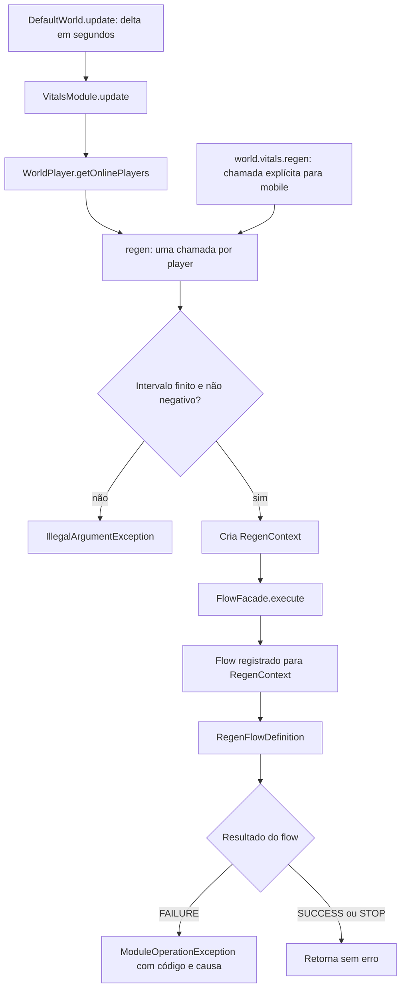
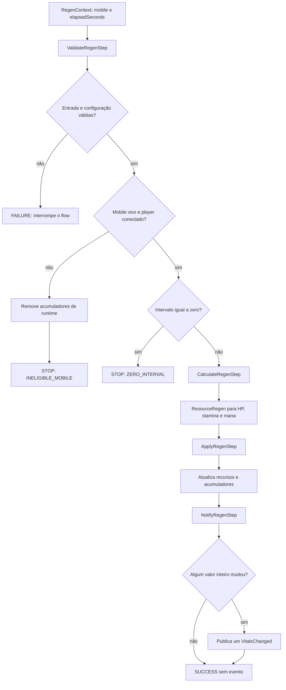
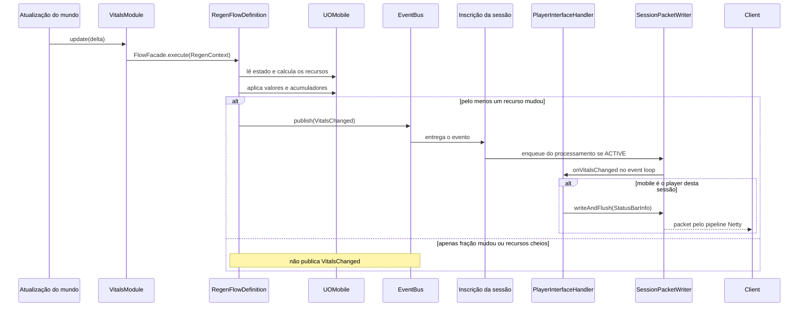

# Vitals e regeneração

O módulo `game.vitals` controla a regeneração de HP, stamina e mana. Ele é independente de combat e expõe a operação `world.vitals().regen(mobile, elapsedSeconds)`.

Este documento descreve a implementação atual. A aplicação de dano ainda altera HP pelo flow de damage; morte e ressurreição continuam no módulo mobile. A extração da regeneração não centralizou todas as alterações de recursos em vitals.

## Atributos e recursos

| Atributo usado no cálculo | Recurso regenerado | Valor atual / máximo |
| --- | --- | --- |
| STR (`strength`) | HP | `hitpoints` / `maxHitpoints` |
| DEX (`dexterity`) | Stamina | `stamina` / `maxStamina` |
| INT (`intelligence`) | Mana | `mana` / `maxMana` |

STR, DEX e INT são entradas da fórmula; a regeneração não aumenta esses atributos nem recalcula os máximos dos recursos.

## Organização

```text
game/vitals/
├── WorldVitals.java                # API pública de regeneração
├── VitalsModule.java               # API + ciclo de vida de WorldModule
├── VitalsModuleImpl.java           # Atualização e execução pelo FlowFacade
└── flow/regen/
    ├── RegenContext.java           # Mobile, intervalo e resultados por recurso
    ├── RegenFlowDefinition.java    # Composição das quatro etapas
    ├── ValidateRegenStep.java
    ├── CalculateRegenStep.java
    ├── ApplyRegenStep.java
    └── NotifyRegenStep.java
```

`FlowRegistryFactory` registra `RegenFlowDefinition` para `RegenContext`. Durante a inicialização, `VitalsModuleImpl` recebe o `FlowFacade` pelo `ModuleContext`.

## Entrada e execução

`DefaultWorld.update(delta)` chama `VitalsModule.update(delta)`. O módulo consulta `WorldPlayer.getOnlinePlayers()` e executa uma regeneração por player, usando todo o `delta`, em segundos. Os acumuladores preservam a parte fracionária entre atualizações.

NPCs vivos também são aceitos pela API, mas não participam dessa iteração automática: precisam de uma chamada explícita. Players desconectados e mobiles mortos não regeneram.



O flow é síncrono: cálculo, aplicação e publicação do evento acontecem na chamada ao facade. Ele não agenda uma thread nem utiliza o event loop de rede para alterar os recursos. A camada de sessão encaminha a notificação de saída para seu próprio event loop.

## Etapas do flow



| Etapa | Comportamento |
| --- | --- |
| `ValidateRegenStep` | Verifica mobile, intervalo e fator de saturação; interrompe para mortos, players offline ou intervalo zero. Ao rejeitar um mobile morto/offline, remove seu progresso fracionário. |
| `CalculateRegenStep` | Lê recursos, atributos e acumuladores. Calcula os três resultados sem alterar o mobile nem seus acumuladores. |
| `ApplyRegenStep` | Grava os novos acumuladores e aplica somente os recursos cujo valor inteiro mudou. |
| `NotifyRegenStep` | Publica um único `VitalsChanged` se pelo menos um dos três recursos mudou. |

Cada resultado `ResourceRegen` contém `previous`, `next` e `remainder`. O contexto mantém resultados separados para HP, stamina e mana.

### Validação e interrupção

| Condição | Código do flow | Efeito |
| --- | --- | --- |
| Mobile ausente | `MISSING_MOBILE` | FAILURE; sem cálculo ou aplicação. |
| Intervalo negativo, NaN ou infinito | `INVALID_INTERVAL` | FAILURE no uso direto do flow. Na API do módulo, a validação antecipada lança `IllegalArgumentException`. |
| `saturationFactor <= 0` | `INVALID_REGEN_SETTINGS` | FAILURE; nenhuma alteração de recursos. |
| Mobile morto ou player desconectado | `INELIGIBLE_MOBILE` | STOP; remove os três acumuladores de runtime. |
| Intervalo zero para mobile elegível | `ZERO_INTERVAL` | STOP; preserva recursos e acumuladores. |

A ordem importa: elegibilidade é verificada antes do intervalo zero. Um mobile morto/offline tem seus acumuladores removidos mesmo com intervalo zero, desde que entrada e configuração sejam válidas.

## Fórmula de regeneração

O cálculo é realizado independentemente para cada recurso.

| Símbolo | Significado |
| --- | --- |
| `S` | Atributo efetivo: `max(0, stat)`. |
| `K` | `settings.mobile().vitals().saturationFactor()`, obrigatoriamente positivo. |
| `dt` | Tempo transcorrido, em segundos. |
| `A` | Acumulador fracionário anterior, inicialmente zero. |
| `C` | Valor atual do recurso. |
| `M` | Valor máximo do recurso. |

Para `C < M`:

```text
S = max(0, stat)
rate = 0.1 + S / (S + K)                   # pontos por segundo
accumulated = A + rate * dt
capacity = M - C
gain = min(floor(accumulated + 1e-9), capacity)
next = C + gain

se next == M:
    remainder = 0
senão:
    remainder = max(0, accumulated - gain)
```

O `1e-9` é uma tolerância contra erros de ponto flutuante próximos de um inteiro. Ela evita que um total representado como `0.9999999999999999` deixe de conceder um ponto.

Se `C >= M`, a etapa mantém o valor atual e retorna acumulador zero. Portanto, a regeneração impede que um novo ganho ultrapasse o máximo, mas não corrige um valor que já esteja acima do máximo por outra alteração.

### Efeito do fator de saturação

Os exemplos abaixo usam **K = 100 apenas para ilustrar a fórmula**, sem afirmar que esse é o valor configurado na shard.

| Atributo efetivo | Cálculo | Taxa aproximada |
| --- | --- | --- |
| 0 | `0.1 + 0 / 100` | 0,1 ponto/s |
| 50 | `0.1 + 50 / 150` | 0,433333 ponto/s |
| 100 | `0.1 + 100 / 200` | 0,6 ponto/s |
| 200 | `0.1 + 200 / 300` | 0,766667 ponto/s |

Um atributo negativo é tratado como zero. Para um mesmo atributo positivo, aumentar K reduz a taxa. Conforme o atributo cresce, a parcela `S / (S + K)` aproxima-se de 1; a taxa aproxima-se de 1,1 ponto/s.

### Exemplo 1: recuperação em uma chamada

Considere HP = 50/100, STR = 100, K = 100, acumulador zero e intervalo de 10 segundos:

```text
rate = 0.1 + 100 / (100 + 100) = 0.6
accumulated = 0 + 0.6 * 10 = 6
capacity = 100 - 50 = 50
gain = min(6, 50) = 6
next = 50 + 6 = 56
remainder = 6 - 6 = 0
```

Resultado: **HP = 56/100**. DEX e INT passam pela mesma fórmula para stamina e mana, com seus próprios valores e acumuladores.

### Exemplo 2: preservação das frações entre ticks

Com os mesmos STR e K, HP inicial 50/100 e atualizações de 1 segundo:

| Tick | HP antes | Acumulador anterior | Total após somar 0,6 | Ganho | HP depois | Resto |
| --- | --- | --- | --- | --- | --- | --- |
| 1 | 50 | 0,0 | 0,6 | 0 | 50 | 0,6 |
| 2 | 50 | 0,6 | 1,2 | 1 | 51 | 0,2 |
| 3 | 51 | 0,2 | 0,8 | 0 | 51 | 0,8 |
| 4 | 51 | 0,8 | 1,4 | 1 | 52 | 0,4 |
| 5 | 52 | 0,4 | 1,0 | 1 | 53 | 0,0 |

Os números estão apresentados em decimal idealizado; a tolerância trata pequenas diferenças da representação em `double`. Após 10 ticks de 1 segundo, o ganho é 6, igual ao de uma chamada de 10 segundos, mantendo atributos, elegibilidade e espaço disponível constantes.

Nos ticks 1 e 3, somente o acumulador de HP muda. Se nenhum outro recurso mudar seu valor inteiro, não há `VitalsChanged`.

### Exemplo 3: limite máximo e descarte do excedente

Considere HP = 98/100, STR = 100, K = 100 e intervalo de 10 segundos:

```text
accumulated = 6
capacity = 100 - 98 = 2
gain = min(6, 2) = 2
next = 100
remainder = 0                          # recurso chegou ao máximo
```

Resultado: **HP = 100/100**. Os 4 pontos excedentes não são guardados. Atualizações com o recurso cheio também mantêm acumulador zero.

Se posteriormente HP cair para 90, uma nova atualização de 1 segundo acumula 0,6 e não concede HP imediatamente. A segunda acumula 1,2 e concede 1 ponto. Isso evita guardar regeneração enquanto o recurso está cheio para recuperar dano futuro instantaneamente.

### Exemplo 4: taxas independentes

Com K = 100, todos os recursos em 50/100, acumuladores zero e intervalo de 10 segundos:

| Recurso | Atributo | Taxa | Ganho inteiro | Novo valor | Resto aproximado |
| --- | --- | --- | --- | --- | --- |
| HP | STR = 100 | 0,6/s | 6 | 56 | 0 |
| Stamina | DEX = 50 | 0,433333/s | 4 | 54 | 0,333333 |
| Mana | INT = 0 | 0,1/s | 1 | 51 | 0 |

Os três valores são aplicados antes da publicação de **um único evento** para o mobile.

## Acumuladores e persistência

Os acumuladores vivem em `mobile.runtimeAttributes()`:

- `vitals.hpAccumulator`
- `vitals.staminaAccumulator`
- `vitals.manaAccumulator`

Eles não são gravados nos atributos persistentes. Um novo objeto carregado começa sem esse progresso fracionário. A validação também remove os acumuladores quando o flow é chamado para um mobile morto ou um player offline.

Como a atualização automática percorre apenas a lista de players online, ela não executa uma varredura de personagens offline para limpar acumuladores. A remoção por inelegibilidade ocorre quando o flow é efetivamente chamado.

## Notificação ao client



Atualmente `onVitalsChanged` atualiza o status do próprio player da sessão. Esse evento, por si só, não envia a barra de vida de um NPC para todos os observadores. A distribuição e os controles de rede estão detalhados em [Sessões do servidor](server-sessions.md).

## Uso e testes

A operação pública usa segundos, não milissegundos:

```java
world.vitals().regen(npc, 1.0); // Regenera considerando 1 segundo transcorrido.
```

O chamador explícito deve fornecer o tempo realmente transcorrido. Não deve repetir a mesma janela de tempo para um player já processado pela atualização automática, pois isso aplicaria regeneração adicional.

Os testes de vitals cobrem o registro do flow, integração com o módulo, entradas inválidas, STOP para inelegibilidade/intervalo zero, cálculo sem mutação, aplicação antes da notificação, taxas independentes, ganhos fracionários, limite máximo, descarte do excedente, estado de runtime e propagação de falhas.

```shell
mvn -o -Dtest=VitalsModuleTest,RegenFlowTest test
```

## Referências no código

- [VitalsModuleImpl](../src/main/java/com/github/mayconr/juoserver/game/vitals/VitalsModuleImpl.java)
- [WorldVitals](../src/main/java/com/github/mayconr/juoserver/game/vitals/WorldVitals.java)
- [RegenFlowDefinition](../src/main/java/com/github/mayconr/juoserver/game/vitals/flow/regen/RegenFlowDefinition.java)
- [RegenContext](../src/main/java/com/github/mayconr/juoserver/game/vitals/flow/regen/RegenContext.java)
- [ValidateRegenStep](../src/main/java/com/github/mayconr/juoserver/game/vitals/flow/regen/ValidateRegenStep.java)
- [CalculateRegenStep](../src/main/java/com/github/mayconr/juoserver/game/vitals/flow/regen/CalculateRegenStep.java)
- [ApplyRegenStep](../src/main/java/com/github/mayconr/juoserver/game/vitals/flow/regen/ApplyRegenStep.java)
- [NotifyRegenStep](../src/main/java/com/github/mayconr/juoserver/game/vitals/flow/regen/NotifyRegenStep.java)
- [FlowRegistryFactory](../src/main/java/com/github/mayconr/juoserver/game/world/context/FlowRegistryFactory.java)
- [PlayerInterfaceHandler](../src/main/java/com/github/mayconr/juoserver/network/session/handler/PlayerInterfaceHandler.java)
- [VitalsModuleTest](../src/test/java/com/github/mayconr/juoserver/game/vitals/VitalsModuleTest.java)
- [RegenFlowTest](../src/test/java/com/github/mayconr/juoserver/game/vitals/RegenFlowTest.java)
